# RingVeto Showcase

        

Public showcase repository for **RingVeto**, a cross-platform app that **identifies and blocks spam and scam calls** on Android and iOS. Users build their own blocking rules (exact numbers, prefixes, suffixes, digit patterns, organisations, caller names sent by the carrier), and the app enforces them through each platform's native call-screening API. All rules and call history stay on the device.

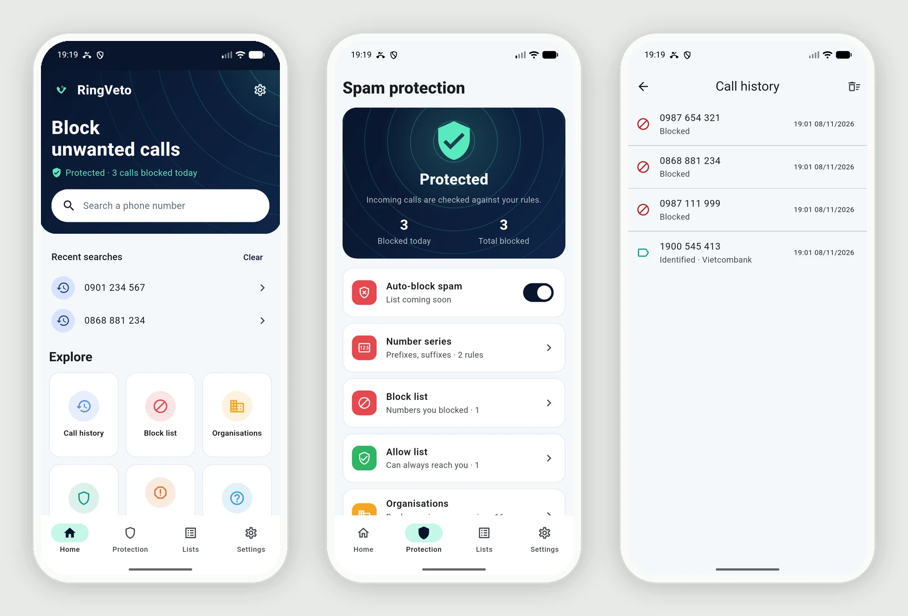

Real screenshots from the Android emulator and iOS Simulator with demo data.

## At A Glance

| | |
|---|---|
| **Project type** | Personal project, built for the Google Play Store and Apple App Store |
| **Platforms** | Android 10+ and iOS 14+ from **one Flutter codebase** |
| **Code size** | ~6,800 lines of Dart · ~470 lines of Kotlin · ~280 lines of Swift |
| **Tests** | 72 unit tests: phone number normalisation, rule matching on a real SQLite engine, iOS list generation, spam list updates, backup round trip, translation completeness |
| **Languages** | English, Vietnamese and Simplified Chinese. Follows the phone language by default, switchable in Settings |
| **Main stack** | Flutter, Dart, Riverpod, SQLite, Kotlin (`CallScreeningService`), Swift (CallKit Call Directory Extension), Google AdMob |
| **Source code** | Private. I am happy to walk through it in an interview |
| **Backend** | None. No server, no account, no sign-up and no personal data asked. The shared spam list is the static file [`data/spam_list.json`](data/spam_list.json) in this repository |
| **Privacy policy** | [canhle1993.github.io/RingVeto-showcase/privacy](https://canhle1993.github.io/RingVeto-showcase/privacy/) (GitHub Pages, English · Tiếng Việt · 简体中文) |

## Quick Links

- [Overview](#overview)
- [My Contributions](#my-contributions)
- [Screenshots](#screenshots)
- [Languages](#languages)
- [Brand And Visual Design](#brand-and-visual-design)
- [Engineering Highlights](#engineering-highlights)
- [Architecture](#architecture)
- [Incoming Call Flow](#incoming-call-flow)
- [Platform Differences](#platform-differences)
- [Testing](#testing)
- [Tech Stack](#tech-stack)
- [Project Status](#project-status)
- [Private Source Code Note](#private-source-code-note)
- [Author](#author)

## Overview

Spam and scam calls are a daily problem in Vietnam. Most caller-ID apps solve it with a cloud database and require a phone-number login. This app takes the opposite approach: **everything runs offline on the phone**.

- **Rules:** block or label calls by exact number, prefix (`024…`), suffix (`…999`), digit pattern, or the caller name the carrier sends with the call
- **Organisations:** group many numbers under one name (bank, carrier, delivery company). A built-in list ships with the app, and users can add their own
- **Allow list:** numbers that always ring through, even if they match a blocking rule
- **Caller ID:** iOS shows the label right on the incoming call screen. Android shows a heads-up notification while the phone rings
- **Number lookup:** search any number to see whether it will be blocked, labelled or allowed, then block or allow it in one tap. A paste button checks a number copied from the phone's Recents list
- **Known scam prefixes:** an optional built-in group of international prefixes often used for scam calls (+224, +231, +232, +247, +252, +255, +370), off by default
- **Shared spam list:** the app downloads a public list of reported numbers from [`data/spam_list.json`](data/spam_list.json) at most once a day. It is a static file on GitHub, so updating the list needs no server, and the app keeps working offline with the last copy
- **Backup and restore:** export every rule, organisation and setting to a JSON file through the system share sheet (Files, Drive, email…) and restore it on a new phone. Restoring merges with existing rules and skips duplicates
- **Report to the carrier:** one tap opens the Messages app with a ready-made report to 5656, the Vietnamese short code for spam calls and SMS. The user reviews and sends it; the app never sends SMS itself
- **History (Android):** a log of blocked and identified calls with daily stats
- **Three languages:** English, Vietnamese and Simplified Chinese, following the phone language by default
- **Onboarding** that guides the user through the system settings needed on each platform and detects when protection is switched on. It never asks for a phone number, email or name: with no server, that data would serve no purpose

## My Contributions

- Designed the architecture so that almost all logic lives in shared Dart code and the native parts stay thin
- Built the rule engine on SQLite, including a single matching query that the Kotlin call-screening service reads straight from the database
- Implemented Android call screening in Kotlin (`CallScreeningService`, `RoleManager`, notifications) and the iOS CallKit Call Directory Extension in Swift
- Wrote the generator that turns rules into the sorted number lists iOS requires, including prefix expansion and memory limits
- Built the Flutter UI: onboarding flow, home, number search, protection dashboard, rule lists, organisations and settings, in light and dark mode
- Applied the RingVeto brand across both platforms: app icons, adaptive and themed Android icons, launch screens and notification icon
- Integrated Google AdMob with the UMP consent flow and App Tracking Transparency on iOS
- Localised the whole app into English, Vietnamese and Simplified Chinese: about 345 strings across Flutter, Android notifications and the iOS permission prompt
- Added a server-free spam list feed, file-based backup and restore, a carrier report shortcut and a public privacy policy page on GitHub Pages
- Wrote the unit tests and verified real call blocking on the Android emulator with simulated incoming calls

## Screenshots

### Onboarding

The first-run flow explains the app, then guides the user through the system permission needed on each platform. The app detects when protection is switched on and moves to the next step by itself. There is no sign-up and no phone number to enter.

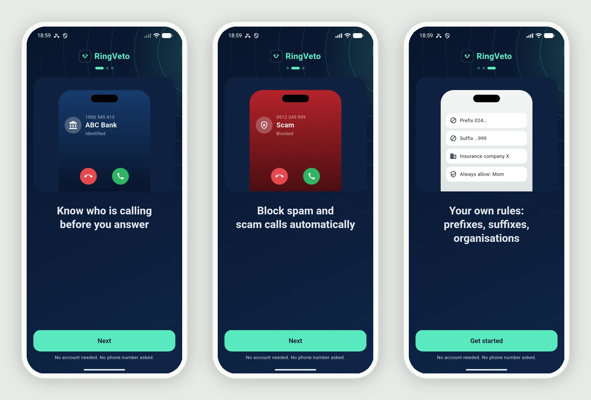

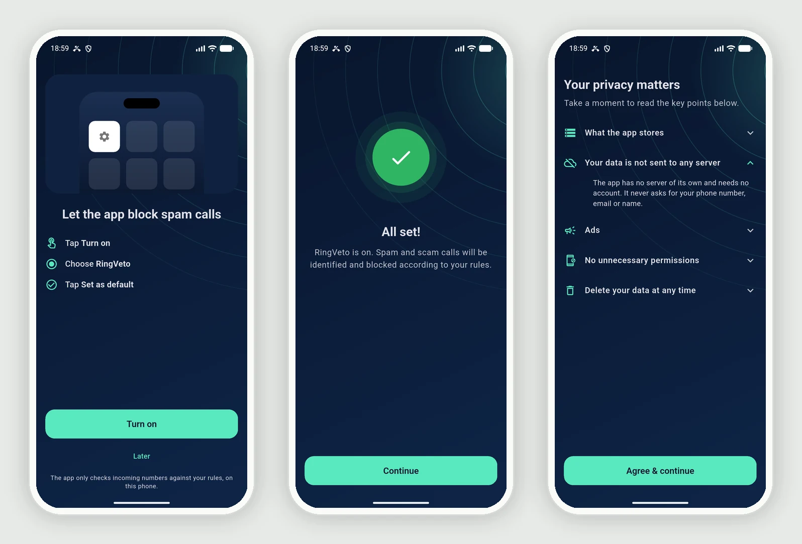

### Number lookup and caller ID

Search any number to see what will happen when it calls, then block it or always allow it in one tap. On Android, labelled numbers show a caller ID notification while the phone rings.

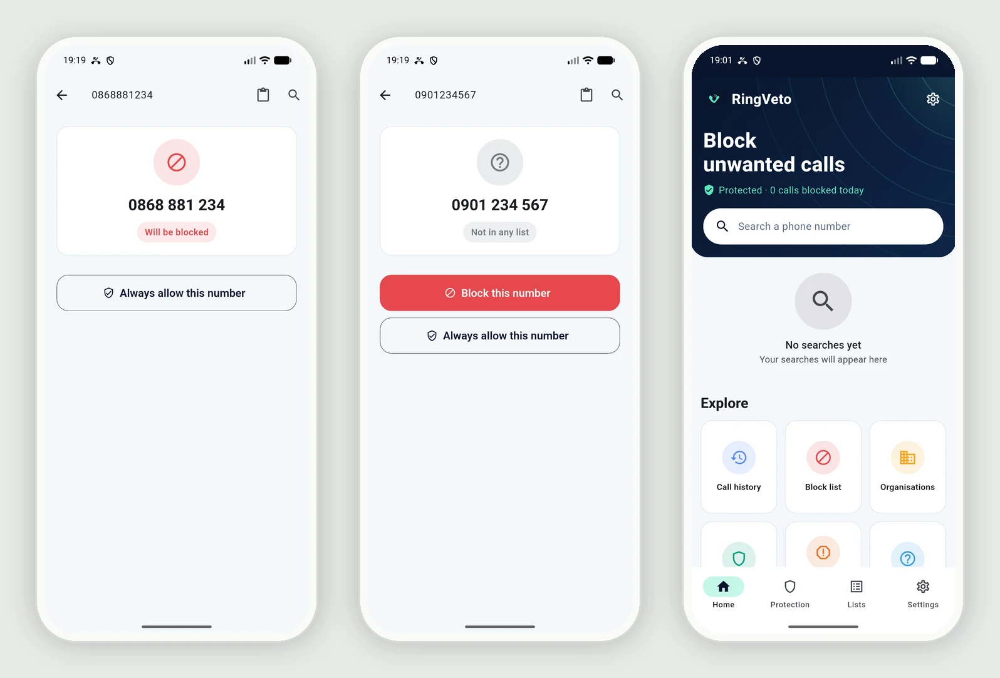

### Rules and organisations

Rules are grouped into blocked numbers, number series (prefix, suffix, digit pattern, caller name), the allow list and organisations. Each organisation can be blocked, labelled or always allowed as a whole. A built-in group of international scam prefixes (+224, +231, +232, +247, +252, +255, +370) is off by default.

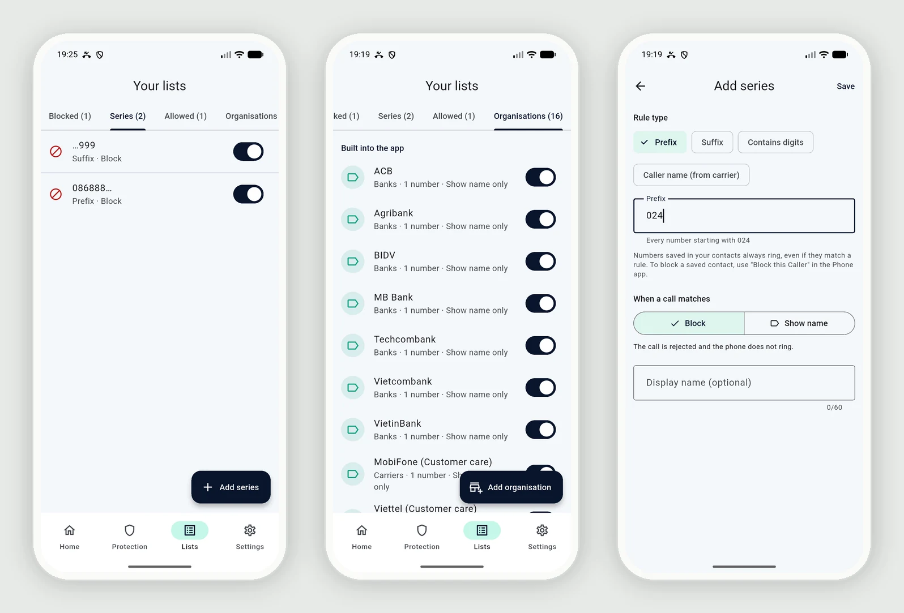

### Settings, FAQ and about

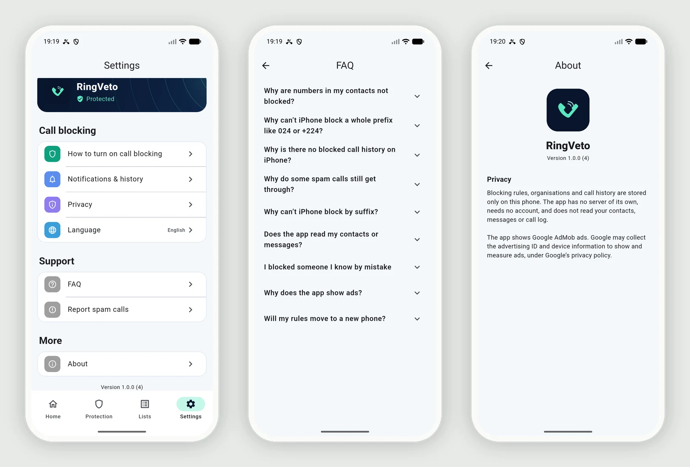

### Dark mode

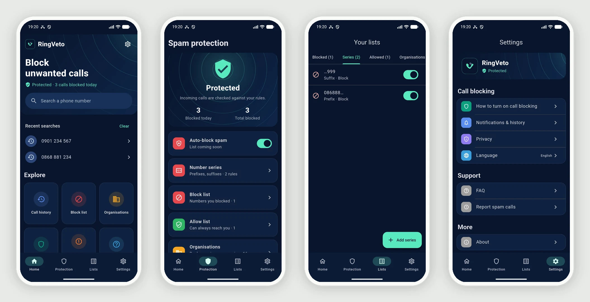

### iOS

The same Flutter UI runs on iPhone, with a native launch screen and a setup guide for Settings → Phone → Call Blocking & Identification.

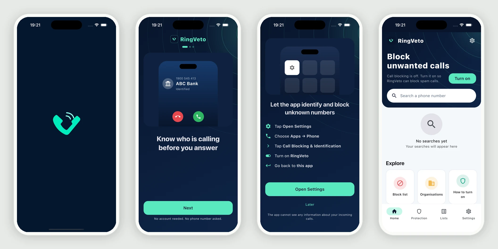

On iPhone the rule editor shows live how many numbers a prefix will cover, refuses prefixes iOS cannot handle, and points the user to the built-in "Silence Unknown Callers" setting instead.

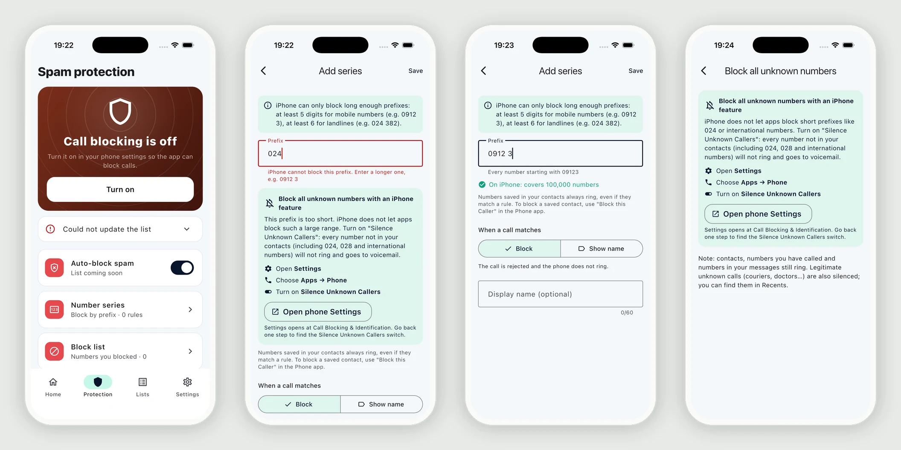

## Languages

The app is fully translated into **English**, **Vietnamese** and **Simplified Chinese**. It follows the phone language by default (any other language falls back to English) and can be switched at any time in Settings → Language, without restarting.

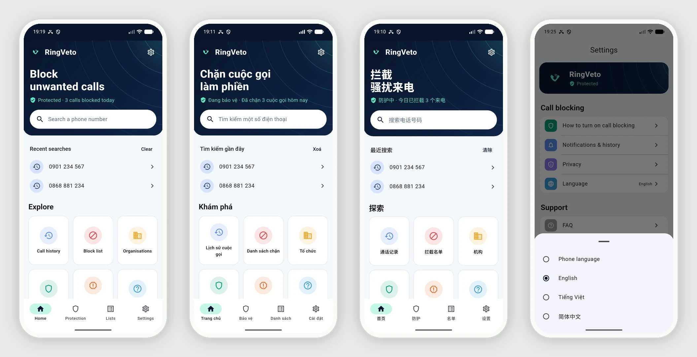

- **Flutter:** `flutter gen-l10n` with ARB files in `lib/l10n/`, about 345 strings, ICU plurals for English ("1 number", "3 numbers") and locale-aware number formatting ("100,000" / "100.000")
- **Built-in data:** organisation names and categories are translated in `organizations.json`, and the iOS caller ID labels are rebuilt when the language changes
- **Native code:** Android notifications use `values`, `values-vi` and `values-zh` resources and follow the language chosen in the app; the iOS tracking prompt uses `InfoPlist.strings` in `en`, `vi` and `zh-Hans`
- **Native layers send codes, not sentences:** Swift returns error codes and the Dart side translates them, so every message lives in one place
- **Tests** check that all three languages have the same keys and placeholders, and that no Vietnamese text is left in the other two

## Brand And Visual Design

- **Brand kit:** navy `#08152C` and mint `#59E8BE`, with a handset-shaped "V" mark. designed for this app
- **App icons:** an iOS icon in every size Xcode needs, and an Android adaptive icon with separate background, foreground and monochrome layers (themed icons on Android 13+)
- **Launch screens:** the mark on navy, through the Android 12+ SplashScreen API, a layer-list fallback for Android 10 and 11, and a storyboard on iOS
- **Notification icon:** the mark redrawn as an Android vector drawable from the SVG source
- **Ripple background:** concentric mint rings on navy, drawn with a `CustomPainter`, echo a ringing phone. They appear on onboarding, the home header and the protection status card, while lists and settings stay on plain backgrounds for readability
- **Themes:** light mode uses navy for primary actions with mint accents. Dark mode uses navy surfaces with mint actions. Both follow the system setting

## Engineering Highlights

- **One source of truth for matching.** The SQL query that decides block / label / allow is written once in Dart and stored in the database. The Kotlin service runs that exact query on every incoming call, so the priority rules (allow > block > label, exact > prefix > suffix) are covered by Dart unit tests instead of being duplicated in two languages
- **Fast, offline call screening on Android.** The service answers Android within about 100 ms on a background thread, works even when the Flutter app is not running, and opens SQLite directly in WAL mode so it can write history while the app is open
- **iOS within CallKit's limits.** iOS does not let apps inspect calls in real time, only preload a sorted list. A Dart generator expands prefix rules into concrete numbers, removes allowed numbers, keeps the most specific label per number and caps the list size. It runs in a background isolate and writes atomic files into an App Group that the Swift extension streams in 64 KB chunks to stay under the extension memory limit
- **Vietnamese phone numbers handled properly.** `0912 345 678`, `+84 912 345 678` and `0084…` all normalise to the same key, including 1800/1900 hotlines, and caller names are matched without Vietnamese diacritics
- **Database migrations** with versioned schema steps, so existing users keep their rules when the app updates
- **Thin native layer.** The platform bridge is a single `MethodChannel`. Native code only screens calls, shows notifications and loads the iOS list
- **Ads that respect the user:** AdMob banners only, Google UMP consent where required, and an App Tracking Transparency prompt on iOS with a plain explanation screen first
- **Server-free updates.** The spam list is fetched over HTTPS from a static file with a version number, a size cap and a 24-hour throttle. A newer version replaces only that list's rules in one transaction; anything malformed is ignored and the old list stays
- **Portable backups.** The backup format is versioned JSON keyed by rule type and pattern, not database IDs, so it survives schema changes and merges cleanly into an existing install
- **Release hardening:** R8 keep rules for WorkManager (used by the ads SDK), which otherwise crashes Android release builds at launch

## Architecture

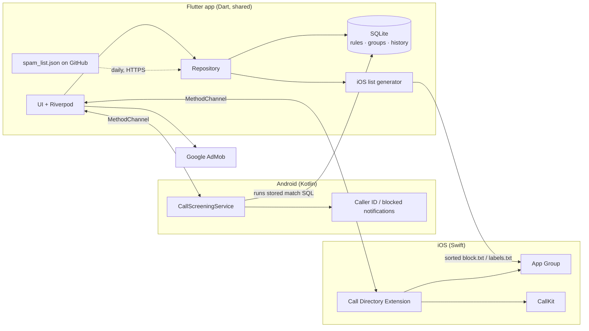

## Incoming Call Flow

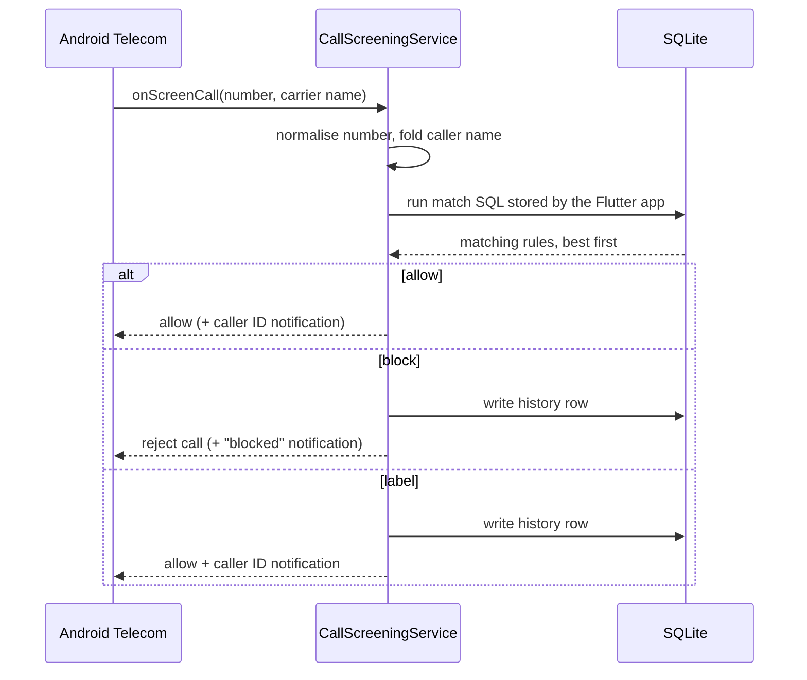

On iOS the system calls the Call Directory Extension only when the app asks it to reload, for example after the user changes a rule, and the extension hands CallKit the precomputed lists.

## Platform Differences

Both operating systems allow call blocking, but in very different ways. The app is honest about this in the UI and marks Android-only rules on iOS.

| Feature | Android | iOS |
|---|:---:|:---:|
| Block exact numbers | ✅ | ✅ |
| Block by prefix | ✅ | ✅ when the prefix leaves ≤ 5 digits |
| Block by suffix / digit pattern | ✅ | ❌ |
| Block by carrier caller name | ✅ | ❌ |
| Block hidden numbers | ✅ | ❌ (built-in iOS setting) |
| Caller ID label | Notification | On the call screen |
| Blocked call history | ✅ | ❌ (iOS never tells the app) |
| Numbers saved in Contacts | Always ring (system rule) | Always ring (system rule) |

Both systems always let saved contacts ring, so a call blocker cannot block them. The app explains this in the rule editor and the FAQ, and points to the phone's own "Block this caller" option. On iPhone, a prefix rule must leave at most 5 free digits (a mobile prefix of at least 5 digits, such as `0912 3`), because iOS needs every blocked number listed up front: `024` alone would be 100 million numbers.

## Testing

- **72 unit tests** run with `flutter test`, including translation completeness checks
- Rule matching tests run the real SQL against SQLite through `sqflite_common_ffi`, the same query the Kotlin service executes on Android
- Normalisation tests cover the same input cases the Kotlin copy must handle
- iOS generator tests check ascending order, no duplicates, prefix expansion and allow-list handling
- Spam list and backup tests cover version checks, malformed input, merge without duplicates and a full export → import round trip
- Manual end-to-end checks on the Android emulator: simulated incoming calls (`adb emu gsm call`) were blocked or labelled as expected, and history and notifications updated live
- iOS UI checked on the iOS Simulator. The Simulator has no call blocking store, so the Call Directory Extension needs a real iPhone

## Tech Stack

- **App:** Flutter 3.44, Dart 3.12, Riverpod, Material 3 with light and dark brand themes, `flutter_localizations` + `intl` (en, vi, zh-Hans)
- **Storage:** SQLite via `sqflite`
- **Android:** Kotlin, `CallScreeningService`, `RoleManager`, notification channels
- **iOS:** Swift, CallKit Call Directory Extension, App Groups, App Tracking Transparency
- **Ads:** Google Mobile Ads (AdMob) with User Messaging Platform consent
- **Device integration:** `share_plus` (export), `file_picker` (import), `url_launcher` (SMS composer, privacy page)
- **Tooling:** `flutter_lints`, `sqflite_common_ffi` for tests, `xcodeproj` scripting for the Xcode extension target

## Project Status

The app is feature complete for a first release and runs on both platforms. Call blocking is verified on Android. iOS blocking needs a real device and an Apple Developer account for the App Group. Store submission is the next step.

Before the store release:

- Replace the Google **test** AdMob IDs with production IDs
- Fill [`data/spam_list.json`](data/spam_list.json) with verified spam numbers. Installed apps pick up a new `version` within a day
- Have the Simplified Chinese translation reviewed by a native speaker

## What This Repository Hosts

The app has no backend, so the two public files it needs live here:

- **Privacy policy:** [`docs/privacy/`](docs/privacy/), published with GitHub Pages at [canhle1993.github.io/RingVeto-showcase/privacy](https://canhle1993.github.io/RingVeto-showcase/privacy/)
- **Spam list feed:** [`data/spam_list.json`](data/spam_list.json), downloaded by the app over HTTPS at most once a day

## Private Source Code Note

The full source code is private. This repository explains the product, architecture and my part of the work. If you are a recruiter, interviewer or reviewer, I can provide:

- a guided walkthrough of the code
- a live demo on an Android phone or iPhone
- more detail on any design decision above

## Author

**Lê Văn Cảnh** · Developer · Ho Chi Minh City, Vietnam

- Portfolio: [canhle1993.github.io/canhle-portfolio](https://canhle1993.github.io/canhle-portfolio/)
- Email: [aplevancanh1993@gmail.com](mailto:aplevancanh1993@gmail.com)
- GitHub: [@canhle1993](https://github.com/canhle1993)
